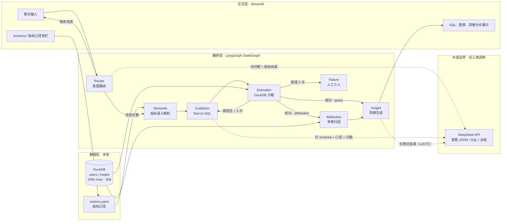
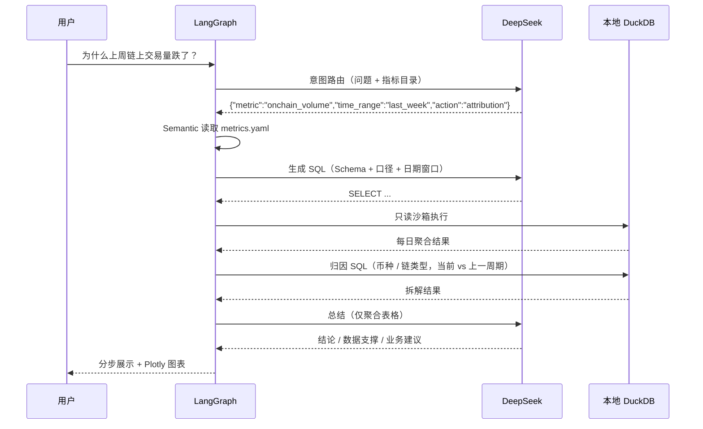
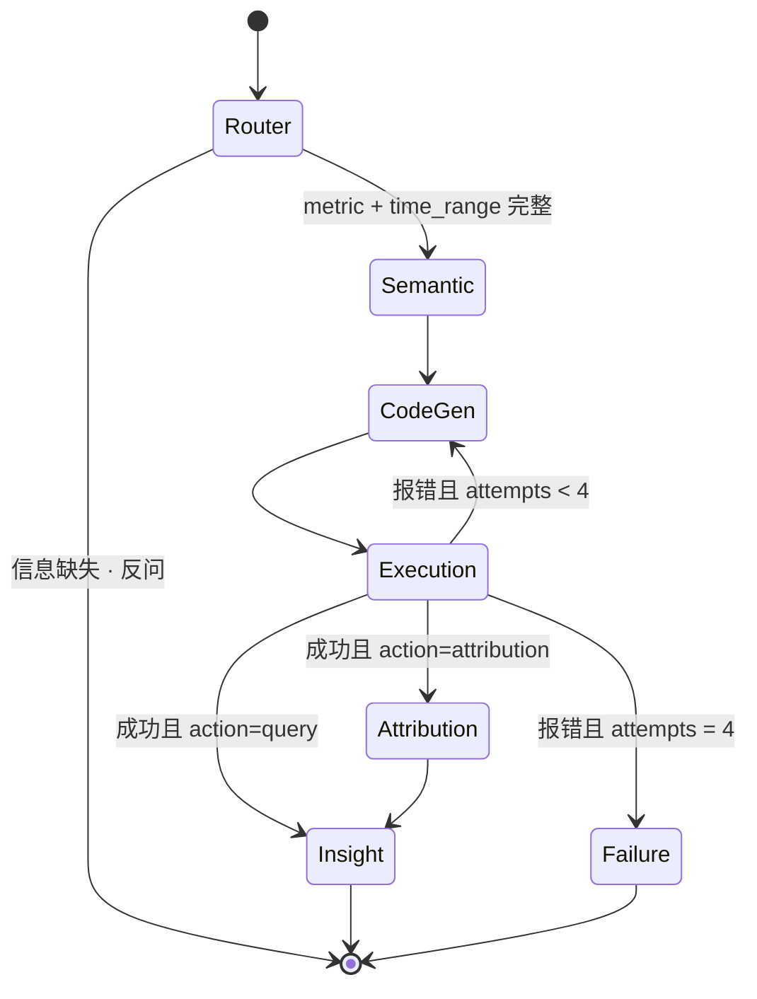

# Text-to-SQL 业务自主式分析与链上数据智能查询 Agent 框架

> 一个**本地优先、成本受控、可解释**的分析 Agent：自然语言 → 受治理 SQL → DuckDB 只读沙箱 → 多维归因 → 结论前置的业务洞察。


-FFF000?logo=duckdb&logoColor=black)

-4D6BFE)


[](https://github.com/DingBangBang/Text-to-SQL_agent_framework/actions/workflows/ci.yml)

> 仓库地址：[github.com/DingBangBang/Text-to-SQL_agent_framework](https://github.com/DingBangBang/Text-to-SQL_agent_framework)

---

## 1. 项目定位

链上业务团队每天都在问三类问题：

1. **是多少**：过去 7 天链上交易量是多少？
2. **为什么**：为什么上周链上交易量跌了？
3. **怎么办**：哪个币种/链类型拖累了大盘，下一步该做什么？

传统 Text-to-SQL Demo 只解决第 1 类，且把原始数据、Schema、甚至全表样本塞进 Prompt，既不安全也不便宜。本项目把问题拆成一条**可审计的状态机**：

- **语义层先行**：所有指标口径固化在 `metrics.yaml`，LLM 不允许自创口径；
- **确定性归因**：涨跌拆解由模板 SQL 完成，不依赖 LLM 写 SQL；
- **本地沙箱**：DuckDB 只读连接 + 单语句校验 + 结果行数上限；
- **成本硬约束**：tiktoken 预算 3,000 tokens/请求、SQL 自纠错 ≤ 3 次、单次运行 ≤ ¥1。

## 2. 核心特性

| 能力 | 实现 | 价值 |
| --- | --- | --- |
| 多智能体编排 | LangGraph `StateGraph`，6 个业务节点 + 失败终止节点 | 每一步可观测、可单测 |
| 指标语义层 | `metrics.yaml` + `SemanticRegistry` | 口径唯一事实来源，防止指标漂移 |
| Text-to-SQL | DeepSeek 生成，模板 SQL 兜底 | 模型故障也不阻断分析 |
| SQL 自纠错 | 报错回传 CodeGen，最多 3 次 | 首次 + 3 次重试后人工介入 |
| 多维归因 | 按日 / 按币种（链类型等未被口径固定的维度），当前 vs 上一等长窗口 | “为什么跌”有数据支撑 |
| 本地数仓 | DuckDB，10 万条模拟交易 / 30 天 | 零外部数据服务依赖 |
| 成本护栏 | tiktoken + 成本计量 + 运行上限 | 单次真实运行约 ¥0.01 量级 |
| 交互式 UI | Streamlit + Plotly | 思考过程、SQL、图表、洞察分层展示 |
| 离线测试 | MockLLM + 小样本 DuckDB | 全套测试 0 API 调用 |

## 3. 系统架构





**边界原则**：虚线表示唯一的外网出口。原始明细、`user_id`、`trade_id`、逐笔记录**永不离开本机**。

## 4. 成本极限控制（单次 < ¥1）

### 4.1 只让模型做三件事

| 调用点 | 输入内容 | 输出 | 典型 tokens |
| --- | --- | --- | --- |
| Router | 用户问题 + 指标目录 + 时间窗口枚举 | ≤ 100 字 JSON | ~900 in / 60 out |
| CodeGen | Schema DDL + 单指标契约 + 问题 + 报错（仅重试时） | 一条 SQL | ~800 in / 150 out |
| Insight | 问题 + 口径 + ≤20 行日粒度表 + ≤8 行归因表 | 结构化中文分析 | ~1200 in / 400 out |

**归因 SQL 不调用 LLM**：模板由语义层生成，既省钱又避免“模型编造归因”。

### 4.2 四道硬闸门

1. **tiktoken 输入预算（`MAX_INPUT_TOKENS=3000`）**
   `src/token_budget.py` 在每次请求前计算消息 token（含 role 开销），超限时优先截断最长的非 system 消息，保留头 70% + 尾 30%，并在文末标记“已按 Token 预算截断”。若仍超限，则只保留最后一条消息并强制裁剪。**预算判断发生在 HTTP 请求之前**，不存在“先花钱再截断”。
2. **SQL 自纠错上限 3 次**
   `Execution` 抛出的错误回传 `CodeGen`，状态机最多执行 `首次 + 3 次重试`；第 4 次仍失败即进入 `Failure` 节点，返回“执行失败，请人工介入”，不会无限循环烧钱。
3. **成本计量与运行上限（`MAX_RUN_COST_CNY=1.0`）**
   `DeepSeekLLM` 记录每次 `usage`（含缓存命中 token），按可配置单价累计；下一次调用前预估成本，若可能突破 ¥1 直接拒绝请求。
4. **结果集与提示词瘦身**
   沙箱单次最多返回 2,000 行；进入 Prompt 的表格最多 20 行/8 行；归因每个维度最多 20 行；HTML 报告最多展示 25 行。

### 4.3 成本估算

以 DeepSeek 官方价格量级（输入 ¥2 / 百万 tokens，缓存命中 ¥0.2，输出 ¥3 / 百万 tokens，均可在 `.env` 调整）计算，**本次真实 E2E 实测**：

```text
3 次调用：Router + CodeGen + Insight
输入 1,520 tokens × ¥2/1M   = ¥0.0030
输出   592 tokens × ¥3/1M   = ¥0.0018
合计                        = ¥0.0048   （约为 ¥1 上限的 0.5%）
```

即使发生 3 次 SQL 自纠错（最多 7 次调用），按同一单价估算成本仍在 ¥0.02 以内——距离 ¥1 上限有一个数量级以上缓冲。`outputs/e2e_result.html` 的页脚与 KPI 卡片会展示每次运行的实际 token 与成本。

### 4.4 防止“无脑调 API 调试”

- 默认 `LLM_MODE=mock`，开发、单测、UI 演示全部走本地 MockLLM；
- `run_e2e_test.sh` 发现 `outputs/e2e_result.html` 已存在时**拒绝再次调用真实 API**，必须显式 `--force`；
- 真实 E2E 仅运行一次，结果落盘为 HTML/JSON，后续调试读取报告即可；
- HTTP 层仅对 429/5xx 做一次传输重试，**不对模型输出做自动重试**。

## 5. 数据隐私声明

1. **存储本地化**：所有明细存放在 `data/analytics.duckdb`，不依赖任何云数仓；`.gitignore` 排除数据库与 `environment.env`。
2. **计算本地化**：SQL 在本地 DuckDB 只读连接执行；连接禁用外部文件访问、限制内存与线程；DDL/DML、`ATTACH`、`COPY`、`read_csv` 等一律拒绝。
3. **外发最小化**：只有以下内容会发送给 DeepSeek——
   - 用户问题文本；
   - 指标名称/口径/Schema 字段名；
   - **聚合后**的结果（最多 20 行，仅日期、维度值、金额/人数），不含 `user_id`、`trade_id`、逐笔明细。
4. **密钥本地化**：`DEEPSEEK_API_KEY` 仅存于本地 `environment.env`，已被 `.gitignore` 排除；代码不打印密钥。
5. **无遥测**：项目不接入任何埋点、不上传日志；唯一外网请求为 `https://api.deepseek.com/chat/completions`。
6. **可离线运行**：`LLM_MODE=mock` 时整个系统可在断网环境完成路由、SQL、执行、归因、报告全流程。

## 6. 快速开始

```bash
# 1) 创建环境（Python 3.11）
conda env create -f environment.yml
conda activate analytics-agent

# 2) 配置（Mock 模式可以不填 Key）
cp environment.env.example environment.env
#    编辑 environment.env：填入 DEEPSEEK_API_KEY，按需将 LLM_MODE 改为 deepseek

# 3) 生成 30 天 / 10 万条本地数据
python simulate_data.py --force

# 4) 离线测试（不消耗任何 API）
pytest -q

# 5) 启动看板（默认 MockLLM）
streamlit run app/dashboard.py
#    浏览器打开 http://localhost:8501

# 6) 真实端到端（仅一次，生成 HTML 报告）
./run_e2e_test.sh
```

> `simulate_data.py` 会注入一个可解释的信号：最近 7 天链上交易量与链上占比同时下降，因此“为什么上周链上交易量跌了？”能跑出真实归因，而不是随机噪声。


## 7. 目录结构

```text
Text-to-SQL_agent_framework/
├── app/
│   └── dashboard.py              # Streamlit：侧栏 Schema/口径 + 分步结果
├── src/
│   ├── config.py                 # Settings：env、预算、价格、路径
│   ├── token_budget.py           # tiktoken 计数与强制截断
│   ├── llm.py                    # DeepSeek 客户端 + 成本计量 + JSON 解析
│   ├── mock_llm.py               # 确定性 MockLLM（零成本）
│   ├── semantic.py               # metrics.yaml → Metric/TimeWindow/SQL 模板
│   ├── routing_rules.py          # 关键词/时间窗口兜底规则
│   ├── db.py                     # DuckDB 只读沙箱 + SQL 白名单校验
│   ├── prompts.py                # 三类 Prompt（路由/SQL/洞察）
│   ├── state.py                  # AgentState + AgentContext
│   ├── graph.py                  # LangGraph 组装、条件边、run_agent
│   ├── reporting.py              # Markdown/HTML/JSON 报告 + SVG 占位图
│   └── nodes/
│       ├── router.py             # 意图路由 + 缺失信息反问
│       ├── semantic_node.py      # 指标 → 表达式/维度/窗口
│       ├── codegen.py            # LLM SQL + 模板兜底
│       ├── execution.py          # 沙箱执行 + 重试路由
│       ├── attribution.py        # 日/币种/链类型归因（不调 LLM）
│       └── insight.py            # 洞察生成 + Failure 终止节点
├── tests/
│   ├── conftest.py               # 小样本 DuckDB、固定 today
│   ├── test_pipeline.py          # Router→Insight、归因、反问、重试上限
│   ├── test_semantic.py          # 同义词、时间窗口、模板 SQL
│   ├── test_db_sandbox.py        # 只读/注入/行数上限
│   ├── test_token_budget.py      # 3000 token 硬上限
│   └── test_reporting.py         # HTML/JSON/占位图
├── scripts/run_e2e_test.py       # 单次 E2E + HTML 报告
├── run_e2e_test.sh               # conda 环境封装 + 防重复计费
├── .github/workflows/ci.yml      # GitHub Actions：离线测试（MockLLM）
├── simulate_data.py              # 20k 用户 / 100k 交易 / 30 天
├── metrics.yaml                  # 指标口径（唯一事实来源）
├── environment.yml               # conda 环境 analytics-agent
├── environment.env.example       # 环境变量模板
├── requirements.txt
├── Makefile
└── outputs/
    ├── e2e_result.html           # 真实运行报告（README 链接）
    └── streamlit_dashboard_placeholder.svg
```

## 8. Agent 节点说明

| 节点 | 文件 | 行为 | 是否调用 LLM |
| --- | --- | --- | --- |
| **Router** | `nodes/router.py` | 输出 `{metric, time_range, action, clarification}`；校验 key 是否存在；缺失信息则终止并反问 | ✅ 1 次 |
| **Semantic** | `nodes/semantic_node.py` | 从 `metrics.yaml` 取出表达式、固定过滤、维度、当前/上一窗口 | ❌ |
| **CodeGen** | `nodes/codegen.py` | Prompt 注入 Schema + 契约；清洗 Markdown 围栏；失败时可用语义模板兜底 | ✅ 1 次（可重试） |
| **Execution** | `nodes/execution.py` | 只读连接 + 单语句白名单 + 行数上限；异常写入 `sql_error` | ❌ |
| **Attribution** | `nodes/attribution.py` | 计算当前/上一周期总量；按未被口径固定的维度做 `FULL OUTER JOIN`，求 `change_value/change_pct` | ❌ |
| **Insight** | `nodes/insight.py` | 将日粒度表 + 归因表送入模型，输出“结论 / 数据支撑 / 业务建议” | ✅ 1 次 |
| **Failure** | `nodes/insight.py` | 3 次自纠错耗尽后返回“执行失败，请人工介入” | ❌ |

### 8.1 状态机与条件边



`AgentState` 使用 `Annotated[list, operator.add]` 累积 `trace` 与 `llm_calls`，因此 UI 可以完整回放每个节点的决策与 token 消耗。

## 9. 语义层与指标口径

`metrics.yaml` 是唯一口径来源。核心指标：

| 指标 key | 名称 | 口径 | 单位 |
| --- | --- | --- | --- |
| `active_users` | 活跃用户 | 窗口内 `COUNT(DISTINCT user_id)` | 人 |
| `trade_volume` | 交易量 | 窗口内 `SUM(trade_volume_usd)` | USD |
| `onchain_volume` | 链上交易量 | `SUM(trade_volume_usd)`，固定过滤 `chain_type = 'onchain'` | USD |
| `fee_revenue` | 手续费收入 | `SUM(fee_usd)` | USD |
| `avg_trade_size` | 平均单笔交易额 | `AVG(trade_volume_usd)` | USD |

时间窗口：`today`、`yesterday`、`last_7_days`、`last_14_days`、`last_30_days`、`last_week`（上一自然周周一至周日）、`this_month`、`last_month`。所有窗口均为**闭区间**，且包含结束日当天。

新增指标只需在 YAML 中追加一项：

```yaml
metrics:
  my_metric:
    label: 我的指标
    description: 业务口径一句话
    table: trades
    alias: t
    time_column: trade_date
    expression: SUM(t.fee_usd)          # 受治理的度量表达式
    value_column: my_metric
    filters: ["t.chain_type = 'onchain'"]
    unit: USD
    synonyms: [我的指标, my metric]
    dimensions:
      trade_date: {label: 日期, expr: CAST(t.trade_date AS DATE), type: time}
      symbol: {label: 币种, expr: t.symbol, type: category}
```

无需改代码，Router 的同义词匹配、Semantic 的 SQL 模板、Attribution 的维度拆解都会自动生效。


## 10. 测试

```bash
pytest -q                       # 全部离线测试
pytest -q tests/test_pipeline.py -k "retry or attribution"
```

测试使用 `tests/conftest.py` 中的小样本 DuckDB（800 用户 / 12,000 交易 / 30 天）和固定日期 `2026-10-20`，因此**完全确定性、无需网络**。

| 测试文件 | 覆盖点 | 用例数 | 结果 |
| --- | --- | ---: | --- |
| `test_pipeline.py` | Router→Insight 全链路、归因、缺失信息反问、SQL 自纠错、3 次重试上限、坏 JSON 兜底 | 7 | ✅ |
| `test_semantic.py` | 同义词映射、自然周窗口、模板 SQL、固定维度跳过、异常模式 | 9 | ✅ |
| `test_db_sandbox.py` | 只读查询、9 类危险 SQL 拒绝、数据未被修改、行数上限、Schema 快照 | 14 | ✅ |
| `test_token_budget.py` | token 计数、3000 硬上限、超大消息截断、头尾保留 | 5 | ✅ |
| `test_reporting.py` | HTML 全部分区、JSON 序列化、Markdown 百分比/金额、SVG 占位图 | 4 | ✅ |
| `test_dashboard.py` | Streamlit AppTest：页面渲染 + 点击示例问题跑通整条链路 | 2 | ✅ |

```text
$ pytest
41 passed, 1 warning in 1.64s
```

> 测试全程使用 MockLLM，真实 API 调用次数为 **0**。

## 11. 端到端真实运行

```bash
./run_e2e_test.sh     # 单次真实调用；已存在报告时默认拒绝重跑
```

**本次运行（唯一一次真实 API 调用链）**

| 项目 | 实测值 |
| --- | --- |
| 运行日期 | 2026-10-20 |
| 模式 / 模型 | `deepseek` / `deepseek-chat` |
| 问题 | 为什么上周链上交易量跌了？ |
| 路由结果 | `onchain_volume` · `last_week` · `attribution`（来源 `deepseek`） |
| SQL 尝试次数 | **1**（无重试） |
| 返回行数 | 7（按日） |
| 归因维度 | `symbol`（`chain_type` 已被指标固定过滤，自动跳过） |
| 输入 / 输出 tokens | **1,520 / 592**（合计 2,112） |
| 实测成本 | **¥0.0048**（约为 ¥1 上限的 0.5%） |
| 总耗时 / SQL 执行 | 5.89 s / 24 ms |
| 状态 | `completed` |

**📄 完整报告：[outputs/e2e_result.html](outputs/e2e_result.html)**（自包含 HTML，含 Plotly 图、SQL、归因表与完整洞察）

**Streamlit 界面（占位截图，可用 `streamlit run app/dashboard.py` 替换为真实截图）**


**真实洞察节选**

> 上周链上交易量环比下降 43.64%，从 $8.55M 降至 $4.82M；下跌是全面性的，BTC、ETH 等主流资产与稳定币同步收缩，其中 ETH 和 BTC 的绝对减少额最大，是主要拖累。
>
> - 按资产看，BTC 减少 $1.08M（-41.68%）、ETH 减少 $1.06M（-48.44%），两者合计减少约 $2.14M。
> - 跌幅比例上 ARB 最深（-51.01%），ETH 次之（-48.44%）。
> - 建议优先排查 10-14 前后主流币流动性变化，并对 L2/公链类资产做专项做市检查。

**成本与调用说明**：本次端到端共 3 次 DeepSeek 请求（Router、CodeGen、Insight），全部输入均低于 3,000 tokens 预算；没有触发 SQL 自纠错。运行结束后报告已落盘，后续调试只读取 HTML/JSON，不再调用真实 API。

## 12. Streamlit 界面

界面按 Agent 的决策顺序分层展示，避免“只给一个黑箱答案”：

1. **KPI 行**：当前值、上一周期、环比、Token/成本；
2. **① 思考过程**：路由到的指标/窗口/动作，以及每个节点的 trace；
3. **② 生成的 DuckDB SQL**：可复制、可审计，并显示 SQL 来源（`deepseek` / `semantic-template`）与尝试次数；
4. **③ 执行数据**：Plotly 折线/柱状图 + 原始聚合表；
5. **④ 多维归因**：按币种等维度展示当前 vs 上一周期的拆解（已被指标过滤固定的维度自动跳过）；
6. **⑤ 智能洞察**：结论前置的分析文案。

侧栏固定展示：本地 Schema（含行数）、`metrics.yaml` 指标口径、成本护栏参数、示例问题，以及 Mock/DeepSeek 模式切换。

```bash
streamlit run app/dashboard.py
```

> 默认 Mock 模式，适合演示与开发；切换到 DeepSeek 需要 `environment.env` 中配置 Key，且每次运行都受 3,000 tokens / ¥1 上限保护。

## 13. 安全边界（威胁模型）

| 风险 | 防护 |
| --- | --- |
| 模型生成写操作（DROP/DELETE/UPDATE） | 只读连接 + 单语句校验 + 关键字黑名单 |
| 读取本地敏感文件（`read_csv('/etc/passwd')`） | 禁用外部访问 + 文件函数黑名单 |
| 多语句注入 | 拒绝分号分隔的多条语句 |
| 超大结果拖垮内存/费用 | `LIMIT 2001` 包装 + 2,000 行上限 + 提示词最多 20 行 |
| 无限重试烧钱 | 失败 3 次后终止，返回人工介入 |
| Prompt 注入改变口径 | 指标表达式与过滤条件来自 YAML，不采用模型生成的口径 |
| 密钥泄漏 | `environment.env` 不入库，README/日志不打印 Key |

## 14. 已知限制

1. **Tokenizer 差异**：tiktoken `cl100k_base` 与 DeepSeek 分词器不完全一致，因此预算留有约 10% 安全边际；极端情况下实际 token 可能略低于估算值。
2. **自然语言时间表达的覆盖**：内置 8 个窗口与常见中文/英文别名；更复杂的表达（“双十一那周”“本月至今按周”）会触发反问或需要扩展 `time_ranges`。
3. **非可加指标的归因**：`active_users` 使用 `COUNT(DISTINCT)`，按维度拆解的 `change_value` 之和不等于总量变化；报告已在文案中避免将其解释为严格加总。
4. **语义等价性**：沙箱保证 SQL 只读、只查允许的表，但不做“业务口径等价性证明”；因此 Prompt 中强制原样使用度量表达式，并在 UI 暴露 SQL 供人工复核。
5. **并发与规模**：DuckDB 为单机分析型引擎，适合本地/单实例；高并发写入或 TB 级数据需替换为只读副本/湖仓。
6. **截图**：仓库内为 SVG 占位图；运行 `streamlit run app/dashboard.py` 后可替换为真实截图。
7. **MockLLM 覆盖范围**：规则覆盖本项目指标与时间窗口；新增指标需在 `metrics.yaml` 增加同义词，Mock 才能自动识别（真实 LLM 无此限制）。

## 15. 故障排查

| 现象 | 原因 | 解决 |
| --- | --- | --- |
| `未找到本地数据库` | 未生成数据 | `python simulate_data.py --force` |
| `未检测到 DEEPSEEK_API_KEY` | `environment.env` 未配置 | 复制模板并填入 Key |
| 真实 E2E 拒绝运行（已存在报告） | 防重复计费 | 确认需要重跑后加 `--force` |
| UI 一直使用 Mock | 模式为 mock 或 Key 缺失 | 侧栏切换 DeepSeek，检查 Key |
| `仅允许 SELECT / WITH` | 模型生成了写操作 | 属预期防护；查看 SQL 并调整问题 |
| 图表空白 | 结果只有 1 行或无数值列 | 查看原始数据表，确认指标口径 |

## 16. License

[MIT](LICENSE) © 2026 DingBangBang
