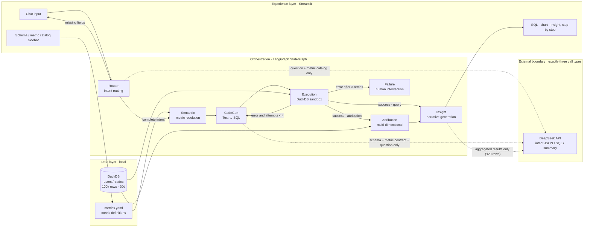
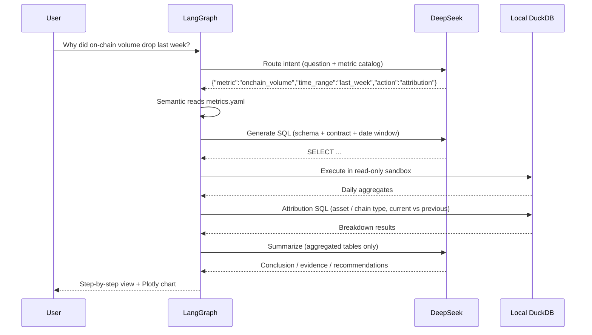
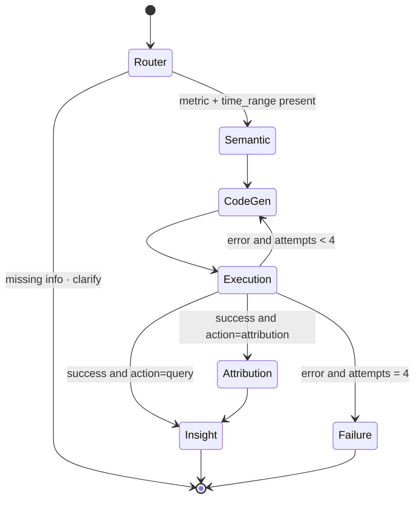
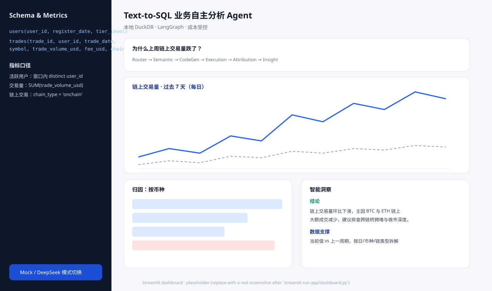

# Text-to-SQL Autonomous Business Analytics & On-Chain Data Agent Framework

> A **local-first, cost-guarded, auditable** analytics agent: natural language → governed SQL → read-only DuckDB sandbox → multi-dimensional attribution → conclusion-first business insight.


-FFF000?logo=duckdb&logoColor=black)

-4D6BFE)


[](https://github.com/DingBangBang/Text-to-SQL_agent_framework/actions/workflows/ci.yml)

> Repository: [github.com/DingBangBang/Text-to-SQL_agent_framework](https://github.com/DingBangBang/Text-to-SQL_agent_framework)
>
> Language: [简体中文](README.md) ｜ **English**

---

## 1. What This Project Solves

On-chain business teams ask three kinds of questions every day:

1. **What happened?** — What was on-chain volume over the last 7 days?
2. **Why did it happen?** — Why did on-chain volume drop last week?
3. **What should we do?** — Which asset or chain segment dragged the total down, and what action should we take next?

Most Text-to-SQL demos only answer the first question, and they stuff raw data, schemas, and even full-table samples into the prompt — insecure and expensive. This project decomposes the problem into an **auditable state machine**:

- **Semantic layer first**: every metric definition is frozen in `metrics.yaml`; the LLM is not allowed to invent a definition.
- **Deterministic attribution**: period-over-period decomposition is generated from template SQL, not written by the LLM.
- **Local sandbox**: DuckDB read-only connection + single-statement validation + hard result-row cap.
- **Hard cost guardrails**: a 3,000-token budget per request, at most 3 SQL self-corrections, and a per-run cap of **$0.14** (code default: 1.0 CNY at the reference rate of 7.1 CNY/USD).

## 2. Key Features

| Capability | Implementation | Why it matters |
| --- | --- | --- |
| Multi-agent orchestration | LangGraph `StateGraph` with 6 business nodes + a failure terminal | Every step is observable and unit-testable |
| Metric semantic layer | `metrics.yaml` + `SemanticRegistry` | Single source of truth prevents metric drift |
| Text-to-SQL | DeepSeek generation with a template-SQL fallback | Analysis survives model/API outages |
| SQL self-correction | Errors are fed back to CodeGen, at most 3 retries | After first attempt + 3 retries, human takeover |
| Multi-dimensional attribution | Daily / by asset (plus any dimension not pinned by the metric), current vs previous equal-length window | “Why did it drop?” is backed by data |
| Local warehouse | DuckDB with 100k simulated trades over 30 days | No external data service required |
| Cost guardrails | tiktoken + cost meter + per-run cap | Typically **under $0.001** per real run |
| Interactive UI | Streamlit + Plotly | Thinking trace, SQL, chart, and insight shown step by step |
| Offline tests | MockLLM + small DuckDB fixture | Full test suite with zero API calls |

## 3. System Architecture





**Boundary principle**: dashed arrows are the only egress. Raw records, `user_id`, `trade_id`, and tick-level rows **never leave the machine**.


## 4. Extreme Cost Control (under $0.15 per run)

### 4.1 Only three kinds of model calls

| Call site | Input | Output | Typical tokens |
| --- | --- | --- | --- |
| Router | User question + metric catalog + time-window enum | JSON, ≤100 words | ~900 in / 60 out |
| CodeGen | Schema DDL + one metric contract + question + error (retry only) | One SQL statement | ~800 in / 150 out |
| Insight | Question + contract + ≤20 daily rows + ≤8 attribution rows | Structured English/Chinese analysis | ~1,200 in / 400 out |

**Attribution SQL never calls the LLM**: templates come from the semantic layer. This saves money and prevents the model from inventing causes.

### 4.2 Four hard gates

1. **tiktoken input budget (`MAX_INPUT_TOKENS=3000`)**
   `src/token_budget.py` counts message tokens (including role overhead) before every request. When over budget, it truncates the longest non-system message, keeping 70% of the head and 30% of the tail and appending a “truncated by token budget” marker. If still over budget, only the last message is kept and hard-trimmed. **The budget check happens before the HTTP request**, so money is never spent on an oversized prompt.
2. **At most 3 SQL self-corrections**
   Errors raised by `Execution` are fed back to `CodeGen`; the state machine performs at most `first attempt + 3 retries`. If attempt 4 still fails, the `Failure` node returns “execution failed, human intervention required” instead of looping and burning credits.
3. **Cost metering and per-run cap (`MAX_RUN_COST_CNY=1.0`, ≈ $0.14 at 7.1 CNY/USD)**
   `DeepSeekLLM` records the provider `usage` for every call (including cached-input tokens), accumulates cost using configurable prices, and estimates the next call before sending it. If the cap would be crossed, the request is rejected.
4. **Result-set and prompt trimming**
   The sandbox returns at most 2,000 rows; prompts include at most 20 daily rows / 8 attribution rows per dimension; each attribution query is capped at 20 rows; the HTML report renders at most 25 rows per table.

### 4.3 Measured cost

DeepSeek list prices used for this document (USD, configurable in the environment file):

- input, cache miss: **$0.28 / 1M tokens**
- input, cache hit: **$0.028 / 1M tokens**
- output: **$0.42 / 1M tokens**

The single real E2E run measured:

```text
3 calls: Router + CodeGen + Insight
Input   1,520 tokens × $0.28 / 1M = $0.0004256
Output    592 tokens × $0.42 / 1M = $0.0002486
Total                             ≈ $0.0006742  (~0.5% of the $0.14 cap)
```

Even with three SQL self-corrections (up to 7 calls), the same unit prices put a run **under $0.003** — more than an order of magnitude below the $0.14 cap. The KPI card and footer of `outputs/e2e_result.html` show the actual token usage and cost of each run.

> The code keeps accounting in CNY (`MAX_RUN_COST_CNY`, price variables are CNY per 1M tokens). All figures above are converted at the reference rate of **7.1 CNY/USD**, which matches DeepSeek's published USD price sheet.

### 4.4 No blind API debugging

- `LLM_MODE=mock` by default: development, unit tests, and UI demos all use the local MockLLM.
- `run_e2e_test.sh` **refuses to call the real API again** when `outputs/e2e_result.html` already exists; a rerun requires an explicit `--force`.
- The real E2E runs once and persists HTML/JSON; later debugging reads the report instead of calling the model.
- At the HTTP layer, only 429/5xx responses get a single transport retry; **model output is never automatically retried**.

## 5. Data Privacy Statement

1. **Local storage**: all detail data lives in `data/analytics.duckdb`; no cloud warehouse is involved. `.gitignore` excludes the database and `environment.env`.
2. **Local compute**: SQL executes through a local, read-only DuckDB connection with external file access disabled and memory/thread limits applied. DDL/DML, `ATTACH`, `COPY`, `read_csv`, and similar operations are rejected.
3. **Minimum egress**: only the following ever reaches DeepSeek:
   - the user's question text;
   - metric names/definitions and schema field names;
   - **aggregated** results (at most 20 rows containing dates, dimension values, and amounts/counts) — never `user_id`, `trade_id`, or tick-level rows.
4. **Local secrets**: `DEEPSEEK_API_KEY` is stored only in the local `environment.env`, which is git-ignored; the code never prints the key.
5. **No telemetry**: the project adds no analytics or log uploads, and Streamlit usage statistics are disabled in `.streamlit/config.toml`. The only outbound request is `https://api.deepseek.com/chat/completions`.
6. **Offline capable**: with `LLM_MODE=mock`, routing, SQL generation, execution, attribution, and report rendering all work without a network connection.

## 6. Quick Start

```bash
# 1) Create the environment (Python 3.11)
conda env create -f environment.yml
conda activate analytics-agent

# 2) Configure (no key needed for Mock mode)
cp environment.env.example environment.env
#    Edit environment.env: add DEEPSEEK_API_KEY, set LLM_MODE=deepseek when needed

# 3) Generate 30 days / 100k trades locally
python simulate_data.py --force

# 4) Offline tests (zero API cost)
pytest -q

# 5) Start the dashboard (MockLLM by default, port 8601)
make dashboard
#    or: streamlit run app/dashboard.py --server.port 8601
#    Open http://localhost:8601

# 6) Real end-to-end run (once, produces an HTML report)
./run_e2e_test.sh
```

> `simulate_data.py` injects an explainable signal: on-chain volume and on-chain share both fall over the most recent 7 days, so “Why did on-chain volume drop last week?” produces a genuine attribution instead of random noise.

> **Port note**: 8501 is frequently occupied by other local services, so this project defaults to **8601** via `.streamlit/config.toml`, the `Makefile`, and `STREAMLIT_PORT`.


## 7. Repository Layout

```text
Text-to-SQL_agent_framework/
├── app/
│   └── dashboard.py              # Streamlit: schema/metric sidebar + step-by-step results
├── src/
│   ├── config.py                 # Settings: env, budgets, prices, paths
│   ├── token_budget.py           # tiktoken counting + forced truncation
│   ├── llm.py                    # DeepSeek client + cost meter + JSON parsing
│   ├── mock_llm.py               # deterministic MockLLM (zero cost)
│   ├── semantic.py               # metrics.yaml → Metric/TimeWindow/SQL templates
│   ├── routing_rules.py          # keyword/time-window fallback rules
│   ├── db.py                     # DuckDB read-only sandbox + SQL allow-list
│   ├── prompts.py                # three prompt families (router/SQL/insight)
│   ├── state.py                  # AgentState + AgentContext
│   ├── graph.py                  # LangGraph wiring, conditional edges, run_agent
│   ├── reporting.py              # Markdown/HTML/JSON reports + SVG placeholder
│   └── nodes/
│       ├── router.py             # intent routing + clarification
│       ├── semantic_node.py      # metric → expression/dimensions/window
│       ├── codegen.py            # LLM SQL + template fallback
│       ├── execution.py          # sandbox execution + retry routing
│       ├── attribution.py        # daily/asset/chain breakdown (no LLM)
│       └── insight.py            # insight generation + Failure terminal
├── tests/
│   ├── conftest.py               # small DuckDB fixture, fixed date
│   ├── test_pipeline.py          # Router→Insight, attribution, clarification, retry cap
│   ├── test_semantic.py          # synonyms, time windows, template SQL
│   ├── test_db_sandbox.py        # read-only/injection/row cap
│   ├── test_token_budget.py      # hard 3,000-token ceiling
│   ├── test_reporting.py         # HTML/JSON/placeholder
│   └── test_dashboard.py         # Streamlit AppTest: render + full question flow
├── scripts/run_e2e_test.py       # one-shot E2E + HTML report
├── run_e2e_test.sh               # conda wrapper + duplicate-billing guard
├── .github/workflows/ci.yml      # GitHub Actions: offline tests (MockLLM)
├── .streamlit/config.toml        # default port 8601, telemetry disabled
├── simulate_data.py              # 20k users / 100k trades / 30 days
├── metrics.yaml                  # metric definitions (single source of truth)
├── environment.yml               # conda environment analytics-agent
├── environment.env.example       # environment template
├── requirements.txt
├── Makefile
└── outputs/
    ├── e2e_result.html           # real-run report (linked below)
    └── streamlit_dashboard_placeholder.svg
```

## 8. Agent Nodes

| Node | File | Behaviour | Calls LLM? |
| --- | --- | --- | --- |
| **Router** | `nodes/router.py` | Emits `{metric, time_range, action, clarification}`; validates keys; terminates with a clarification question when fields are missing | ✅ once |
| **Semantic** | `nodes/semantic_node.py` | Resolves expression, fixed filters, dimensions, current/previous windows from `metrics.yaml` | ❌ |
| **CodeGen** | `nodes/codegen.py` | Injects schema + contract; strips Markdown fences; falls back to governed template SQL on failure | ✅ once (retryable) |
| **Execution** | `nodes/execution.py` | Read-only connection + single-statement allow-list + row cap; failures go to `sql_error` | ❌ |
| **Attribution** | `nodes/attribution.py` | Computes current/previous totals; `FULL OUTER JOIN` on dimensions not pinned by the contract to derive `change_value/change_pct` | ❌ |
| **Insight** | `nodes/insight.py` | Sends daily table + attribution table to the model; outputs “Conclusion / Evidence / Recommendations” | ✅ once |
| **Failure** | `nodes/insight.py` | After 3 exhausted self-corrections, returns “execution failed, human intervention required” | ❌ |


### 8.1 State Machine and Conditional Edges



`AgentState` accumulates `trace` and `llm_calls` through `Annotated[list, operator.add]`, so the UI can replay every node decision and token spend.

## 9. Semantic Layer and Metric Definitions

`metrics.yaml` is the single source of truth. Core metrics:

| Metric key | Name | Definition | Unit |
| --- | --- | --- | --- |
| `active_users` | Active users | `COUNT(DISTINCT user_id)` within the window | users |
| `trade_volume` | Trading volume | `SUM(trade_volume_usd)` within the window | USD |
| `onchain_volume` | On-chain volume | `SUM(trade_volume_usd)` with fixed filter `chain_type = 'onchain'` | USD |
| `fee_revenue` | Fee revenue | `SUM(fee_usd)` | USD |
| `avg_trade_size` | Average trade size | `AVG(trade_volume_usd)` | USD |

Time windows: `today`, `yesterday`, `last_7_days`, `last_14_days`, `last_30_days`, `last_week` (previous Monday–Sunday), `this_month`, `last_month`. All windows are **closed intervals** and include the end date.

Adding a metric only requires a YAML entry:

```yaml
metrics:
  my_metric:
    label: My metric
    description: One-line business definition
    table: trades
    alias: t
    time_column: trade_date
    expression: SUM(t.fee_usd)          # governed measure expression
    value_column: my_metric
    filters: ["t.chain_type = 'onchain'"]
    unit: USD
    synonyms: [my metric, fees]
    dimensions:
      trade_date: {label: Date, expr: CAST(t.trade_date AS DATE), type: time}
      symbol: {label: Asset, expr: t.symbol, type: category}
```

No code changes are needed: Router synonym matching, Semantic SQL templates, and Attribution dimension breakdowns pick it up automatically.

## 10. Tests

```bash
pytest -q                       # full offline suite
pytest -q tests/test_pipeline.py -k "retry or attribution"
```

Tests use a small DuckDB fixture (800 users / 12,000 trades / 30 days) and a fixed date (`2026-10-20`) from `tests/conftest.py`, so they are **fully deterministic and need no network**.

| Test file | Coverage | Cases | Result |
| --- | --- | ---: | --- |
| `test_pipeline.py` | Router→Insight flow, attribution, clarification, SQL repair, 3-retry cap, bad-JSON fallback | 7 | ✅ |
| `test_semantic.py` | Synonym mapping, calendar windows, template SQL, pinned-dimension skip, invalid mode | 9 | ✅ |
| `test_db_sandbox.py` | Read-only queries, 9 dangerous SQL rejections, data integrity, row cap, schema snapshot | 14 | ✅ |
| `test_token_budget.py` | Token counting, hard 3,000 ceiling, oversized truncation, head/tail retention | 5 | ✅ |
| `test_reporting.py` | All HTML sections, JSON export, Markdown money/percent formatting, SVG placeholder | 4 | ✅ |
| `test_dashboard.py` | Streamlit AppTest: page render + clicking an example question end-to-end | 2 | ✅ |

```text
$ pytest
41 passed, 1 warning in 1.64s
```

> The whole suite uses MockLLM; real API calls: **0**.


## 11. Real End-to-End Run

```bash
./run_e2e_test.sh     # one live run; refuses to overwrite an existing report
```

**This run (the single live API chain)**

| Item | Measured value |
| --- | --- |
| Date | 2026-10-20 |
| Mode / model | `deepseek` / `deepseek-chat` |
| Question | Why did on-chain volume drop last week? |
| Route | `onchain_volume` · `last_week` · `attribution` (source `deepseek`) |
| SQL attempts | **1** (no retry) |
| Rows returned | 7 (daily) |
| Attribution dimension | `symbol` (`chain_type` is pinned by the metric filter and skipped) |
| Input / output tokens | **1,520 / 592** (2,112 total) |
| Measured cost | **$0.000674** (~0.5% of the $0.14 cap) |
| Total / SQL latency | 5.89 s / 24 ms |
| Status | `completed` |

**📄 Full report: [outputs/e2e_result.html](outputs/e2e_result.html)** — a self-contained HTML page with the Plotly chart, generated SQL, attribution tables, and the complete insight.

**Streamlit UI (SVG placeholder; replace it with a real screenshot after `make dashboard`)**



**Insight excerpt (translated)**

> On-chain volume fell **43.64% week over week**, from **$8.55M** to **$4.82M**. The decline was broad-based: BTC, ETH, and stablecoins all contracted, with ETH and BTC contributing the largest absolute drops.
>
> - BTC fell by **$1.08M (-41.68%)** and ETH by **$1.06M (-48.44%)**; together they account for roughly **$2.14M** of the decline.
> - ARB had the steepest percentage drop (**-51.01%**), followed by ETH (**-48.44%**).
> - Recommended actions: investigate liquidity around Oct 14 for majors and run a dedicated market-making review for L2/public-chain assets.

**Cost note**: the run made 3 DeepSeek requests (Router, CodeGen, Insight). Every input stayed below the 3,000-token budget and no SQL self-correction was triggered. The report is persisted, so subsequent debugging only reads HTML/JSON and never calls the API again.

## 12. Streamlit Dashboard

The UI follows the agent's decision order instead of showing a black-box answer:

1. **KPI row**: current value, previous period, change %, tokens/cost.
2. **① Thinking trace**: routed metric/window/action plus every node's trace.
3. **② Generated DuckDB SQL**: copyable and auditable, including SQL source (`deepseek` / `semantic-template`) and attempt count.
4. **③ Result data**: Plotly line/bar chart + raw aggregate table.
5. **④ Attribution**: current vs previous period by asset and other informative dimensions (dimensions pinned by the metric are skipped).
6. **⑤ Insight**: conclusion-first narrative.

The sidebar always shows the local schema (with row counts), `metrics.yaml` definitions, cost guardrails, example questions, and a Mock/DeepSeek switch.

```bash
make dashboard
# equivalent to: streamlit run app/dashboard.py --server.port 8601
```


## 13. Security Boundary (Threat Model)

| Risk | Control |
| --- | --- |
| Model generates writes (DROP/DELETE/UPDATE) | Read-only connection + single-statement validation + keyword blacklist |
| Reading local sensitive files (`read_csv('/etc/passwd')`) | External access disabled + file-function blacklist |
| Multi-statement injection | Statements containing internal semicolons are rejected |
| Oversized results exhausting memory/cost | `LIMIT 2001` wrapper + 2,000-row cap + at most 20 prompt rows |
| Unlimited retries burning credits | Pipeline stops after 3 self-corrections and requires human intervention |
| Prompt injection changing metric definitions | Expressions and filters come from YAML, never from the model |
| Key leakage | `environment.env` is never committed; keys are never printed in logs/README |

## 14. Known Limitations

1. **Tokenizer mismatch**: tiktoken `cl100k_base` and DeepSeek's tokenizer are not identical, so the budget keeps roughly a 10% safety margin; actual billed tokens may be slightly lower than the estimate.
2. **Natural-language time coverage**: eight windows and common Chinese/English aliases are built in; more complex phrases ("the week of Singles' Day", "month-to-date by week") trigger a clarification or require extending `time_ranges`.
3. **Non-additive metrics**: `active_users` uses `COUNT(DISTINCT)`, so the sum of dimension-level `change_value` does not equal the total change; the report avoids presenting it as a strict additive decomposition.
4. **Semantic equivalence**: the sandbox guarantees read-only access and allowed tables, but does not formally prove business equivalence. Prompts require the governed expression verbatim, and the UI exposes the SQL for human review.
5. **Concurrency and scale**: DuckDB is a single-node analytical engine, suitable for local/single-instance use; high-concurrency writes or TB-scale data should use a read replica or lakehouse.
6. **Screenshot**: the repository ships an SVG placeholder; replace it after running `make dashboard`.
7. **MockLLM coverage**: rules cover this project's metrics and time windows; new metrics need synonyms in `metrics.yaml` for Mock to recognize them (the real LLM has no such restriction).

## 15. Troubleshooting

| Symptom | Cause | Fix |
| --- | --- | --- |
| `Local database not found` | Data not generated | `python simulate_data.py --force` |
| `DEEPSEEK_API_KEY not detected` | `environment.env` missing the key | Copy the template and add the key |
| Live E2E refuses to run | Report already exists (duplicate-billing guard) | Add `--force` only if a rerun is truly needed |
| UI always uses Mock | Mode is `mock` or the key is missing | Switch to DeepSeek in the sidebar and check the key |
| `Only SELECT / WITH is allowed` | Model generated a write statement | Expected protection; inspect the SQL and refine the question |
| Empty chart | Only one row or no numeric column | Inspect the raw table and confirm the metric definition |

## 16. License

[MIT](LICENSE) © 2026 DingBangBang

> The default port is **8601** (8501 is often occupied by other local services). It is controlled by `.streamlit/config.toml`, the `Makefile`, and `STREAMLIT_PORT`. Mock mode is the default for demos and development; switching to DeepSeek requires a key in `environment.env` and remains protected by the 3,000-token / $0.14 limits.
